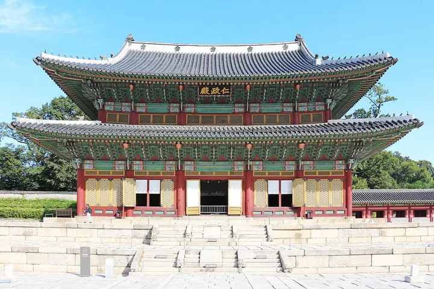

서울에서 궁궐 두세 곳을 하루에 묶어 보려는 분이 가장 많이 헷갈리는 게 **궁마다 쉬는 요일과 문 닫는 시간이 다르다**는 점입니다. 관람료가 곧 오른다는 소식도 있었지만, 10월에는 그 일정이 다시 미정으로 바뀌었다는 보도가 나왔습니다. 이 글은 **2026년 11월 1일에 국가유산청 궁능유적본부 공식 관람안내를 다시 확인한 내용** 기준입니다.

## 한눈에 보기

| 궁궐 | 쉬는 날 | 대인 개인 관람료 | 10인 이상 단체 |
|---|---|---|---|
| 경복궁 | 화요일 | 3,000원 | 2,400원 |
| 창덕궁(전각) | 월요일 | 3,000원 (후원은 별도) | 2,400원 |
| 창경궁 | 월요일 | 1,000원 | 800원 |
| 덕수궁 | 월요일 | 1,000원 | 800원 |

여기서 '대인'은 **내국인 만 25~64세, 외국인 만 19~64세**입니다. 내국인과 외국인의 금액은 같습니다. 각 궁이 있는 기초자치단체 주민은 신분증 등 증빙을 내면 일반관람료의 50%를 할인받지만, 단체요금과 겹쳐 할인받을 수는 없습니다.

정기휴일이 공휴일이나 대체공휴일과 겹치면 그날은 문을 열고, 그다음 첫 번째 평일(비공휴일)에 쉽니다. 기관 사정으로 관람시간이 줄거나 바뀔 수 있으니 방문 전날 <a href="https://royal.khs.go.kr" target="_blank" rel="noopener">궁능유적본부</a> 공지를 확인하세요.

## 몇 시까지 들어가야 하나: 월별 관람시간

경복궁과 창덕궁은 계절에 따라 문 닫는 시간이 달라지고, 창경궁과 덕수궁은 1년 내내 밤 9시까지 엽니다. 표의 괄호 안 시간이 **입장 마감**입니다. 마감 뒤에는 표가 있어도 들어갈 수 없습니다.

| 궁궐 | 기간 | 관람시간 (입장 마감) |
|---|---|---|
| 경복궁 | 11~2월 | 09:00~17:00 (16:00) |
| 경복궁 | 3~5월, 9~10월 | 09:00~18:00 (17:00) |
| 경복궁 | 6~8월 | 09:00~18:30 (17:30) |
| 창덕궁 | 11~1월 | 09:00~17:30 (16:30) |
| 창덕궁 | 2~5월, 9~10월 | 09:00~18:00 (17:00) |
| 창덕궁 | 6~8월 | 09:00~18:30 (17:30) |
| 창경궁 | 1~12월 | 09:00~21:00 (20:00) |
| 덕수궁 | 1~12월 | 09:00~21:00 (20:00) |

겨울(11~2월)에 경복궁을 오후 늦게 가면 오후 4시에 입장이 끝납니다. 반대로 저녁 시간이 남는다면 창경궁이나 덕수궁이 선택지입니다. 두 궁은 별도 예매 없이 일반 관람으로 저녁 8시까지 들어갈 수 있습니다.

## 요일별로 짜는 하루 코스

<figure><figcaption>창덕궁 인정전. 화요일에는 경복궁 대신 창덕궁과 창경궁을 묶어 보세요. 사진 Bernard Gagnon, CC0 (위키미디어 공용)</figcaption></figure>

쉬는 날이 화요일인 곳은 경복궁 하나, 나머지 세 곳은 월요일입니다. 그래서 요일만 잘 고르면 동선이 깔끔해집니다.

- **월요일에 간다면**: 문을 여는 큰 궁은 경복궁뿐입니다. 경복궁을 오전에 충분히 보고, 오후에는 바로 옆 국립고궁박물관이나 서촌 쪽으로 빠지는 일정이 무난합니다.
- **화요일에 간다면**: 경복궁이 쉬므로 창덕궁과 창경궁을 묶으세요. 두 궁은 담 하나를 사이에 두고 붙어 있습니다.
- **수요일에 간다면**: '문화가 있는 날'이라 창덕궁 전각·창경궁·덕수궁이 무료입니다. 경복궁과 창덕궁 후원은 무료에서 빠집니다.
- **목~일요일에 간다면**: 네 곳 모두 엽니다. 경복궁(오전) → 덕수궁(저녁, 밤 8시 입장 마감) 또는 창덕궁 → 창경궁 조합을 추천합니다. 네 곳을 하루에 다 넣으면 각 궁을 겉핥기로 보게 됩니다.

## 지하철로 가는 법

주차장이 좁고 주변 도로가 자주 막히므로 대중교통이 편합니다.

| 궁궐 | 가까운 역 |
|---|---|
| 경복궁 | 3호선 **경복궁역** 5번 출구 (공식 안내 도보 2분), 5호선 광화문역 2번 출구 |
| 창덕궁 | 3호선 **안국역** |
| 창경궁 | 4호선 **혜화역**, 또는 창덕궁에서 이어지는 길 |
| 덕수궁 | 1·2호선 **시청역** (정문 대한문 앞) |

경복궁 오시는 길 외의 출구 번호와 도보 시간은 각 궁 공식 누리집에서 다시 확인하세요. 경복궁과 덕수궁 사이는 광화문광장을 따라 걸어서 이동할 수 있어 오전 경복궁·저녁 덕수궁 일정을 짜기 좋습니다.

## 무료로 들어갈 수 있는 사람

관람료가 싸기도 하지만, 생각보다 많은 사람이 무료 대상입니다. 공식 무료관람 대상 가운데 여행객이 자주 해당하는 경우만 골랐습니다.

- **만 24세 이하, 만 65세 이상 내국인** (신분증 지참)
- **만 18세 이하, 만 65세 이상 외국인**
- 「모자보건법」에 따른 **임산부와 보호자 1인**
- 지자체가 발급한 **다자녀(다둥이)카드를 가진 부모**
- 등록장애인과 장애 정도가 심한 장애인의 동행 보호자 1인
- 독립유공자·국가유공자와 배우자, 기초생활수급자, 군복을 입은 현역군인 등
- **한복을 갖춰 입은 사람** (내·외국인 모두)

무료 대상자는 반드시 증빙을 보여 줘야 하므로 신분증이나 카드를 챙기세요. 전체 목록은 공식 관람요금 페이지에 있습니다.

### 한복은 어디까지 인정되나

궁능유적본부의 한복 무료관람 가이드라인은 다음과 같습니다.

1. 전통한복과 생활한복 모두 인정합니다.
2. **상의(저고리)와 하의(치마·바지)를 함께** 입어야 합니다. 두루마기만 걸친 경우는 인정하지 않습니다.
3. 상의는 여미는 깃 형태를 유지해야 하고, 고름이나 매듭 방식은 상관없습니다.
4. 치마는 여밈 유무와 관계없이 인정합니다.

청바지에 저고리만 입었거나, 한복 하의에 티셔츠를 입은 경우는 무료가 아닙니다. 티셔츠처럼 입는 생활한복 저고리도 한복 저고리로 인정하지 않습니다.

## 창덕궁 후원은 표가 따로다

창덕궁 후원은 **입장 시간과 정원이 정해진 제한관람**입니다. 후원 관람권(대인·경로 5,000원, 만 7~18세 2,500원)과 함께 **창덕궁 전각 관람권도 따로 사야** 합니다. 후원은 단체할인이 없습니다.

- 한국어 관람은 3~10월 오전 10시~오후 4시, 11~2월 오전 10시~오후 3시에 매시 정각 입장합니다.
- 회차당 100명이며 인터넷 예매 50명, 현장 발매 50명으로 나뉩니다.
- 인터넷 예매는 관람일을 빼고 **6일 전 오전 10시부터 하루 전까지** 선착순입니다. 현장 표는 관람 당일 오전 9시부터 팝니다.
- 공식 안내에 따르면 4~5월과 10~11월에는 두 가지 표 모두 매우 빨리 매진됩니다.
- 후원에서 무료가 되는 사람은 만 6세 이하와 내국인 유공자·장애인으로 일반 궁보다 좁습니다. 한복 착용은 후원 무료 대상에 들어 있지 않습니다.

## 통합관람권, 사면 이득일까

**궁궐 통합관람권은 6,000원**이고 4대 궁과 종묘에 각 1회 들어갈 수 있습니다(창덕궁 후원 제외). 구매일로부터 6개월 동안 쓰며 4대 궁과 종묘 매표소에서 삽니다. 환불은 산 곳에서만 되고, 한 곳이라도 쓰면 환불되지 않습니다.

대인 기준으로 경복궁(3,000원)과 창덕궁(3,000원) 두 곳만 가도 6,000원이라 본전입니다. 여기에 창경궁·덕수궁·종묘 중 하나라도 더 가면 통합권이 쌉니다. 반면 만 24세 이하 내국인처럼 무료 대상이거나, 수요일에 창덕궁·창경궁·덕수궁만 볼 계획이라면 통합권을 살 이유가 없습니다.

## 관람료 인상, 지금 확정된 것은 없다

궁궐과 조선왕릉 관람료는 오랫동안 그대로였습니다. 2026년 8월 보도에 따르면 국가유산청은 11월 중 새 관람료 기준을 발표하고 2027년 1월 1일부터 적용하겠다고 밝혔습니다.

그런데 2026년 10월 8일 SBS Biz 보도에 따르면, 국회 문화체육관광위원회 최민희 의원이 받은 궁능유적본부 자료에는 **인상안 마련·발표·시행 시점이 모두 '미정'**으로 적혀 있었습니다. 같은 자료에서 궁능유적본부는 한복 무료관람 제도와 국민 부담, 공공성을 검토해 내년 1월 관람 서비스를 개선하겠다고 밝혔지만, 인상 폭이나 적용 시점은 밝히지 않았습니다.

즉 **2026년 11월 1일 기준 인상 금액과 시행일은 정해지지 않았습니다.** 인터넷에 도는 구체적인 인상 금액은 공식 발표 전에는 근거가 없습니다. 한복 무료 기준이 바뀔 가능성도 있으니, 한복을 입고 갈 계획이라면 방문 직전 공식 가이드라인을 다시 보세요. 공식 발표가 나오면 이 글의 표를 고치고 수정 날짜를 위에 표시하겠습니다.

## 자주 묻는 것

**덕수궁 안 미술관도 같은 표로 들어가나요?**
아닙니다. 덕수궁 관람권과 미술관 관람권을 따로 사야 합니다.

**외국인 친구도 한복을 입으면 무료인가요?**
네. 공식 가이드라인은 한복 대중화·세계화가 취지라 내·외국인 구분 없이 무료로 인정한다고 안내합니다.

**자주 가는데 더 싼 방법이 있나요?**
한 달 동안 관람시간 안에 언제든 들어가는 상시 관람권이 있습니다. 경복궁·창덕궁은 30,000원, 덕수궁·창경궁·왕릉은 10,000원이고 사진 1장을 내야 하며, 산 곳에만 들어갈 수 있습니다(창덕궁 후원 제외). 점심시간에만 쓰는 관람권도 따로 있습니다. 며칠 머무는 여행객이라면 대부분 통합관람권이나 개별 구매가 낫습니다.
